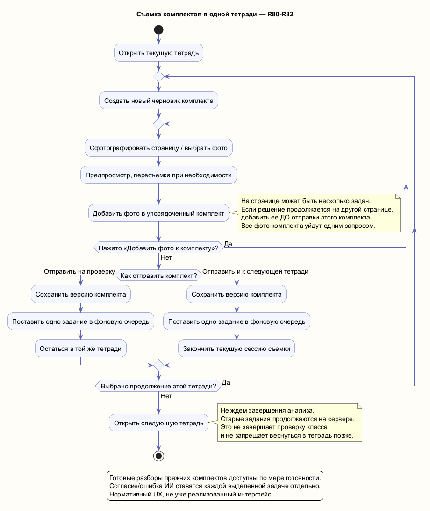

# Проверка страниц: контракт и интеграция в пилот

19.11.2026. Решения R80–R83: [DECISIONS.md](DECISIONS.md). **Промпт и контракт проверены локальным экспериментом; учительское приложение с очередью, хранением и аккаунтами еще предстоит реализовать.** Эталонный адаптер проверен офлайн. Рекомендуемые 25 000 токенов и HTTP-таймаут 300 секунд не были отдельным платным прогоном.

## Поддерживаемый сценарий

Учитель может фотографировать страницу целиком. Требование «одна задача на фото» R07 заменено R80. В одном комплекте изображений допустимы:

| Вход | Как трактуется |
|---|---|
| Одна фотография, одна задача | Один результат задачи |
| Одна фотография, несколько задач или независимых подпунктов | Отдельный результат для каждой самостоятельной задачи |
| Одна задача на двух фотографиях | Один общий результат по обоим фрагментам |
| На первом фото целая задача и начало другой, на втором продолжение | Два результата; продолжение не становится третьей задачей |

Сначала модель рассматривает все вложения одного запроса, связывает фрагменты и только затем оценивает завершенность и первую ошибку. Вложения передаются в порядке съемки. Отдельные отправленные комплекты не имеют общей памяти LLM: продолжение нужно добавить **до отправки**. Не обещаем автоматического объединения уже проверенных независимых запросов.

Эти четыре группы покрыты локальным набором из 76 входов: 20 / 48 / 4 / 4. У one-pass правильно оценены 175 из 175 пригодных появлений задач, выделено верное число задач на 76 из 76 входов. Это сверка агентом по подготовленному ground truth, не независимая учительская валидация и не гарантия для всех реальных фото. Три неоднозначных появления одного исходного подпункта исключены из математической оценки. Три и более вложений, перекрывающиеся снимки и пара полностью независимых фото без продолжения отдельно в этом наборе не измерялись. Подробности: [ai/EVIDENCE.md](ai/EVIDENCE.md).

Выбран основной путь: **один запрос по всем фото комплекта**. В эксперименте staged-путь с предварительным разбиением был медленнее, дороже и дал дополнительные ошибки выделения; его не переносим как обязательный компонент.

## Поток съемки — R81

У текущей условной тетради есть черновик комплекта. В нем предпросмотр, возможность переснять и три действия:

1. **Добавить фото в комплект** — например, снять продолжение. Пока не отправлять.
2. **Отправить на проверку** — отправить все фото черновика одним запросом через серверную очередь; остаться в той же тетради с новым черновиком.
3. **Отправить и перейти к следующей тетради** — отправить комплект и перейти к следующей тетради, не дожидаясь ответа.

Третье действие завершает текущую съемку тетради, а не проверку класса. К тетради можно вернуться и добавить задачи позже. Готовые результаты показываются сразу по готовности, учитель оценивает каждую выделенную задачу отдельно. Закрытие браузера не останавливает принятые сервером задания.

Исходник: [capture-flow.puml](ai/capture-flow.puml), вектор: [SVG](ai/capture-flow.svg). Предлагаемая последовательность клиента, сервера и worker: [capture-async.puml](ai/capture-async.puml), [PNG](ai/capture-async.png). Диаграмма последовательности описывает проектируемую реализацию, не существующий сервер.

## Единицы данных и версии

`Проверка` объединяет условные тетради. `Тетрадь` объединяет комплекты и выделенные задачи. `Фото` не равно `задача`. `Комплект` — совместный вход одного запроса; версия комплекта и попытка обработки различаются.

Предлагаемая реализация: при отправке фиксировать неизменяемую версию входа, порядок фото, notebook/check ID и Job. Повтор приема того же действия должен быть идемпотентным на уровне приложения. Все результаты привязываются к исходной версии и тетради, даже если пользователь уже открыл следующую. Адаптер сам не реализует эту очередь.

Изменение общего фото требует новой проверки затронутого комплекта и снимает прежние согласия на затронутые анализы. Совпадение модельного `task_id`, позиции или похожей формулы не доказывает тождество старой и новой задачи. Удаление одной задачи не должно удалять общее фото соседних задач. Поздний результат не восстанавливает удаленные сущности и не перезаписывает новую версию. Продуктовые правила: [TECHNICAL_PLAN.md](TECHNICAL_PLAN.md), [SUMMARY_METRICS.md](SUMMARY_METRICS.md).

## Замороженный промпт и JSON

Использовать [checker-v2.txt](ai/checker-v2.txt) **как есть**, со схемой `page-check/1.2`: [response-schema-v1.2.json](ai/response-schema-v1.2.json). Происхождение, хеши файла и текста: [provenance.json](ai/provenance.json). Чтение Python нормализует CRLF в LF; поэтому хеш байтов файла отличается от хеша фактического текста сообщения. Оба зафиксированы.

Для провайдера схема упрощается и ограничивает ссылки на фото диапазоном 1..N; полная схема и инварианты проверяются локально. Нельзя просто отправить произвольную полную Pydantic-схему: в эксперименте слишком сложная схема вызывала отказ. Эталон преобразования — [contract.py](ai/contract.py), примеры wire-схем для [одного](ai/wire-schema-1-photo.json) и [двух](ai/wire-schema-2-photo.json) вложений.

| Поле задачи | Значение |
|---|---|
| `task_id`, `locator`, `photo_indices`, `condition` | Локальный ID в ответе, положение, номера вложений, распознанное условие |
| `result` | `all_steps_correct`, `first_error_found` или `not_assessed` |
| `completeness` | `complete`, `incomplete` или `unknown` независимо от правильности |
| `detail_level` и пояснения | Подробность записи; корректное сокращение не является ошибкой |
| `evidence` | До четырех ключевых реально видимых строк с номером фото |
| `first_error` | Неверный шаг, свободное `rule`, пояснение, исправление и номер фото; иначе `null` |
| `uncheckable_reason` | Причина невозможности оценки, когда применимо |

Верхний объект содержит `schema_version`, `status`, `tasks`, `message`. HTTP-успех, успешная валидация ответа и математическая оценимость задачи — разные состояния. `all_steps_correct` при `incomplete` означает корректное видимое начало, не завершенное решение. `not_assessed` не превращается в ноль ошибок или корректную работу.

По R82 выбранной трассировки достаточно для пилота: фото с увеличением, ключевые строки, первый неверный шаг, правило, объяснение и исправление. **Полного OCR всех строк контракт не обещает.** Пропуск строк в `evidence` не означает, что ученик пропустил шаги: `detail_level=omitted_steps` оценивает запись ученика, а не длину ответа модели.

Реальные ответы прогона: [E_C01 — ошибка группировки](ai/examples/E_C01.response.json), [K01 — сокращенная запись](ai/examples/K01.response.json), [M06 — несколько фото](ai/examples/M06.response.json). Это публичные/синтетические dev-примеры; фотографии и production-ответы в переносимую базу не включены. JSON содержит экранированный LaTeX: разобрать JSON один раз и передать строки математическому рендереру, без дополнительного ручного unescape.

Обязательные коды правил сейчас не вводим. Направление отдельной LLM-сводки — [AI_ANALYTICS.md](AI_ANALYTICS.md). [Историческое дополнение классификации](prompts/teacher-error-classification-v1.md) к проверенному тексту автоматически не добавлять. Новое поле/инструкция означает новую версию и повторную валидацию.

## Подключение и границы адаптера

[ai/README.md](ai/README.md) содержит запуск, environment и файлы для переноса; [adapter.py](ai/adapter.py) выполняет один HTTP POST в Polza с упорядоченными изображениями, проверяет ответ и возвращает результат с метаданными. Ключ остается на сервере. В браузер нельзя переносить адаптер или environment с ключом.

Модель `google/gemini-3.8-flash`, закрепленный маршрут `google-ai-studio/flex`, fallback выключен, reasoning `medium`, media resolution `HIGH`, JSON Schema, без streaming. `temperature=0` отправлялась в опыте; это не обещание детерминированности модели. Оригинальные JPEG/PNG/WebP отправляются без resize/reencode; PDF не поддерживается. Локальные технические проверки адаптера: до 8 000 000 байт на фото (8 MB), 36 MP, короткая сторона от 32 px. Это границы эталонного кода, не новые видимые учителям квоты.

`trust_env=False` исключает proxy-переменные окружения, но **не обходит системный TUN**. Прямую маршрутизацию нужно обеспечивать и проверять в серверном окружении отдельно. Экспериментальные Windows-привязки сетевого интерфейса не переносим в приложение.

## Лимиты, сбои и наблюдаемость

Рекомендация для реализации: `max_completion_tokens=25000`, HTTP phase timeout 300 s, connect 15 s; обоснование и границы — [TOKEN_POLICY.md](ai/TOKEN_POLICY.md). Это увеличенный запас относительно тестовых 12k/24k, не гарантия полного ответа и не целевое пользовательское время. HTTPX phase timeout не равен общему deadline фоновой задачи.

В адаптере **нет автоматических повторов**. Единственный согласованный автоповтор временного технического сбоя R78 относится к будущему worker; экспериментальные многократные повторы не являются production-политикой. 400 требует диагностики параметров/контракта, 429 — учета backoff, 5xx — классификации временного сбоя. Повтор после read timeout может быть оплачен дважды: отсутствие ответа не доказывает отсутствие выполнения у провайдера. `finish_reason=length` отбрасывается даже при формально читаемом JSON: не восстанавливаем обрезанный текст и не включаем частичный результат в сводку.

Worker должен хранить попытки, исходный/provider request ID, профиль, версии prompt/schema, состояния очереди, время ожидания/запроса/всей задачи, класс ошибки, завершение, usage, стоимость и повторы. Неизвестная стоимость — `null`, не ноль. Предоставленный `safe_metadata()` не содержит ключей, фотографий и полного разбора. Полные материалы хранятся отдельно с доступом команды для поддержки; их нельзя бесконтрольно дублировать в общие логи. Следить за итоговым time-to-done с учетом ожидания и повторов, а не только за временем успешной попытки.
