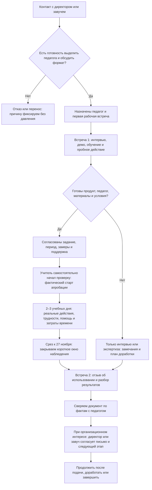
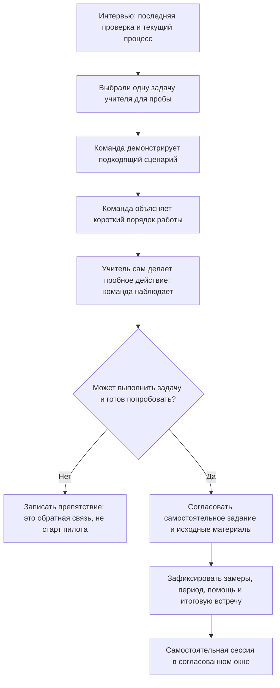
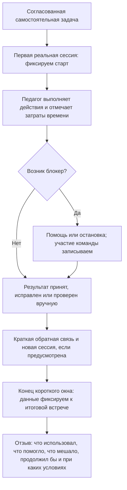
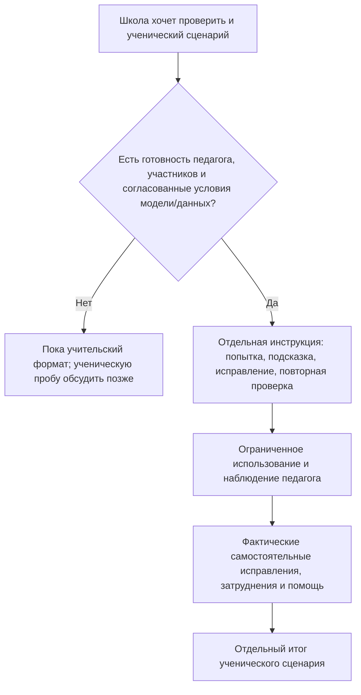

# Школьная апробация: предметный рабочий процесс

Актуализировано: 18 ноября 2026 года. Документ объединяет согласованные решения по первому обращению к школам и рабочее предложение по встречам и апробации. Источник актуализации – обсуждение с автором проекта 17–18 ноября. Общий продуктовый контекст: [PROJECT_CONTEXT.md](PROJECT_CONTEXT.md).

**Основной вход в работу со школами сейчас – учительский сценарий по алгебре 7–9 классов.** В первом письме рассказываем о пользе для педагога, класса и школы. Подробности работы сервиса показываем на встрече. Ученическая часть общей концепции сохраняется для отдельного обсуждения при интересе школы.

Три письма подготовлены, автор также внес ручные правки в первый вариант. Факты отправки, ответы школ, назначенные встречи и проведенные пилоты пока не сообщены. Последние технические сведения получены 17 ноября; новой проверки готовности прототипа при этой актуализации нет.

Общая схема в одном изображении: [PNG, 6000×7600, версия 17 ноября](../../../research-garden/visuals/school-process-2026-11-17.png). Схема отражает общий маршрут, первую встречу, апробацию и возможный отдельный ученический этап. Последующие решения по адресации письма и акцентам коммуникации зафиксированы в тексте ниже; изображение сохранено в прежней версии.

## Текущая стратегия и границы обещаний

| Область | Актуальная договоренность или статус |
|---|---|
| Кто мы | Команда из четырех студентов НИУ ВШЭ – Пермь; проект «Умная тетрадь» |
| Основной запрос школе | Помочь встретиться с одним заинтересованным учителем математики 7–9 классов |
| Предмет первого знакомства | Проверка письменных работ по алгебре и подготовка разбора ошибок |
| Цель для учителя | Сократить рутинную проверку, получить больше времени на объяснения и помощь классу |
| Цель для школы | Проверить возможность снизить повседневную нагрузку педагогов при сохранении качества проверки |
| Ближайший результат команды | Реальная обратная связь; при готовности – самостоятельная учительская апробация |
| Конкурсный контекст | Финальный этап «Проектируем будущее»; подробности финала пока неизвестны. Подготовка заявки на «Студенческий стартап» ФСИ к 1 декабря |
| Граница утверждений | Экономия времени, качество на всей программе и образовательные эффекты требуют измерений |

Принадлежность участников к ВШЭ и статус финалиста помогают объяснить происхождение проекта. Официальное поручение университета и институциональное партнерство требуют собственного подтверждения. Сведения о реализованных функциях сверяем с фактической готовностью к встрече.

## Какую пользу предлагаем обсудить

| Для кого | Предполагаемая польза | Что хотим выяснить на первом этапе |
|---|---|---|
| Учитель | Меньше повторяющейся проверки и подготовки разбора ошибок; сохранение итогового педагогического решения | Сокращается ли полное время, удобны ли замечания, сколько приходится исправлять |
| Класс | Объяснения с учетом реальных затруднений; более предметная помощь при разборе темы | Помогает ли результат проверки учителю выбрать, что повторить и кому помочь |
| Директор и завуч | Поддержка педагогов, управляемая проба инструмента и понятные выводы о его применимости | Соразмерны ли польза и затраты на организацию, стоит ли продолжать |

Интересы конкретного директора или завуча уточняем при общении. Снижение нагрузки и полезность разбора – рабочие гипотезы. Короткий учительский тест дает сведения о процессе проверки; образовательные результаты класса требуют отдельного наблюдения. Публичное представление опыта школы возможно после появления фактических результатов и согласования с участниками.

## Первое обращение и адресация

1. Выбираем школу и проверяем официальный канал связи, наличие подходящих классов и роли адресатов.
2. При обращении на общую почту адресуем письмо директору и завучу по учебной работе. Секретарь помогает передать его ответственным.
3. Короткая тема: **«Директору и завучу: проект студентов ВШЭ для учителей математики»**. ФИО размещаем в обращении внутри письма. При необходимости добавляем отдельную строку маршрутизации: «Просим передать письмо директору [ФИО] и заместителю директора по учебной работе [ФИО]».
4. Основной текст строим в порядке: **кто мы → просьба о встрече → польза учителю, классу и школе → конкретный следующий шаг**.
5. Просим предложить педагога и время встречи на 30–40 минут. Знакомство с продуктом и короткую апробацию обсуждаем последовательно.

В письме используем вежливый личный тон, простые слова, конкретную просьбу и контакты отправителя. Подробности фотографирования, интерфейса, проверки выводов и ограничений показываем при демонстрации. Результаты апробации описываем после ее проведения. Подтверждения для гранта обсуждаем по итогам фактического взаимодействия. Стилевые договоренности: буква «е», короткое тире «–», прямые формулировки без противопоставлений.

Актуальные [три варианта письма](../../../research-garden/runs/2026-11-17T14-52-58Z/appendices/deputy-head-emails.md) имеют разные акценты: время учителя; подготовка разбора ошибок; польза школе и участие в доработке. Первый вариант содержит ручные правки автора и сохраняется как редактируемый черновик.

## Что хотим предоставить школе

Следующая комплектация – рабочее предложение команды. Готовность каждого элемента проверяем перед тем, как обещать его школе.

| Этап | Что готовит или предоставляет команда | Какое участие просим у школы |
|---|---|---|
| Первое знакомство | Краткое объяснение задачи, показ реально готовой части, подготовленные примеры и честное описание ограничений | Один заинтересованный педагог и время для разговора |
| Первая рабочая встреча | Интервью о текущей проверке, демонстрация, объяснение порядка работы и пробное действие педагога | Рассказать о своем процессе и оценить применимость решения |
| Короткая апробация | Доступ к готовому учительскому сценарию, краткая инструкция, согласованный канал помощи и простой способ фиксации результатов | Согласовать небольшую задачу, материалы и срок; самостоятельно попробовать сервис при готовности |
| Подведение итогов | Краткая сводка наблюдений, времени, замечаний и ограничений; предложение следующего шага | Проверить точность выводов, дать отзыв и обсудить продолжение |

Планируемый учительский сценарий: комплект работ, просмотр отдельных решений, правки и подтверждение выводов, сводка повторяющихся ошибок. На 17 ноября эти элементы были планом к 23 ноября. Доступ к самостоятельной пробе зависит от реальной готовности. Материалы первой демонстрации готовит команда; реальные школьные работы, их получение и обработку согласуем отдельно.

Краткая итоговая записка для школы может включать: что попробовали, что оказалось полезным, сколько времени заняло использование, какие ошибки и ограничения обнаружены, какие доработки предложены. Состав записки согласуем по формату участия. Обязательства по цене, закупке, длительности дальнейшего доступа и постоянной поддержке еще предстоит определить.

## Что уточнено автором

- Число писем и встреч – номинальный бюджет; конкретный маршрут зависит от школы. Дополнительные организационные контакты согласуются по необходимости.
- В общей концепции сохраняются учительский и ученический сценарии. Для первого обращения выбран учительский. Учительская апробация достаточна для первого содержательного результата; дополнительный ученический этап обсуждаем по интересу школы.
- Возможный календарь: первая рабочая встреча 23–24 ноября, 2–3 учебных дня использования, итоговая встреча 27 ноября.
- Результат для заявки нужен до 1 декабря. Работа со школой может продолжаться после этого срока.

Ниже предложена конкретизация, которую еще обсуждаем с автором: роли участников, содержание задания, способ загрузки работ и замеры.

## 1. Общий маршрут

Предлагаемый вход – через директора/завуча, потому что ищем участие школы, ответственного и согласованный формат. Это не универсальное требование начинать с директора. При уже имеющемся знакомстве с учителем он может быть первым собеседником; организационное согласование выполняется до соответствующих школьных действий.

Первый организационный контакт не обязан быть отдельной очной встречей. Короткого ответа администрации с назначением педагога может быть достаточно для подготовки интервью. Согласие на разговор не означает автоматического допуска к ученическим данным или самостоятельному использованию учениками.

Финальная рабочая встреча прежде всего с пользовавшимся педагогом. Администрацию можно подключить к ее последней части, если обсуждается организационное продолжение или письмо от школы. При ее отсутствии личный отзыв не выдается за решение организации.

## 2. Первая рабочая встреча

Ориентир первого письма – 30–40 минут; окончательную длительность согласовать со школой. Предлагаемая повестка: интервью 10–12 минут; демо 5–7; объяснение и самостоятельное пробное действие 8–12; договоренности 5–8. Распределение зависит от интереса педагога и фактически готовых возможностей.

**Интервью** выясняет, что и как преподаватель проверяет, как возвращает замечания, что делает после повторяющейся ошибки и где уже использует другие инструменты. Время со слов педагога сохраняется как приблизительная оценка с указанием источника.

**Демонстрация** показывает, что делает система. Показать верное решение, ошибочный шаг и неопределенный случай, затем учительский комплект/правку/сводку в реально готовой части. Если педагог согласен только на интервью, демонстрацию не навязывать.

**Обучение** отвечает на вопрос «как выполнить задачу самому»: вход, загрузка, проверка замечания по фото, принятие/правка, просмотр сводки, сообщение о сбое. Команда готовит короткий лист действий и помогает освоить задачу на встрече.

**Пробное действие** – педагог проходит небольшой пример сам. Вмешательства команды отмечаются: без них нельзя честно понять самостоятельность использования. Проба рядом с разработчиком считается обучением/наблюдением на встрече; ее не смешивать с последующей самостоятельной апробацией.

**Договоренность о тесте** фиксирует одну задачу, объем, тему, происхождение и допустимость материалов, критерий полезности, период, способ учета времени, контакт поддержки и дату итогового разговора. Выдача ссылки или логина без использования еще не является фактически проведенной апробацией.

## 3. Период и границы апробации

Короткое окно заканчивается срезом перед итоговой встречей 27 ноября. Встреча закрывает первый этап оценкой и решением. Возможность дальнейшего доступа обсуждается отдельно. Для продолжения после 1 декабря согласуются новые сроки и задача; новые результаты фиксируются отдельным периодом.

Пока предлагается собирать число фактических работ/сессий, полное активное время, отдельное ожидание, помощь команды, принятые/исправленные/непригодные выводы и действие учителя по сводке. Конкретный протокол зависит от выбранного сценария и еще обсуждается. Без сопоставимой ручной базы нельзя объявлять измеренной экономию времени.

Если педагог не начал работу, фиксируем отсутствие самостоятельного использования и его причину, если она известна. Разбор искусственных примеров учитываем как экспертизу подготовленных материалов с указанием их происхождения.

## 4. Ученический сценарий

Ученический этап требует отдельного согласования. Вопрос маршрута Gemini и допустимости детского сценария в текущем контексте остается открытым. Учительский результат достаточен для первого этапа. В заявке указываем фактический состав участников и проведенных действий.

## 5. Что еще нужно решить вместе с автором

1. Конкретная самостоятельная задача учителя: обычное ДЗ, отдельная проверочная, набор выбранных решений либо только подготовленные примеры.
2. Кто и как получает фотографии; сколько работы по съемке/привязке возникает у педагога.
3. Готовность прототипа к самостоятельному использованию: создание доступа, сохранение комплекта/правок, тайминг/журнал событий и доставка обратной связи.

Шаблоны документов и исследовательское основание: [воронка и методики](../../../research-garden/runs/2026-11-17T14-52-58Z/report.md). Этот файл конкретизирует процесс по новым ответам автора. Готовность перечисленных возможностей подтверждаем фактической проверкой перед встречей.

## 6. Роли администрации и учителя

| Участник | Первый контакт | Рабочая встреча и апробация | Итог |
|---|---|---|---|
| Секретарь / сотрудник общей почты | Передает обращение директору и завучу | Организационная помощь при принятом в школе порядке | Передача документов по согласованному маршруту |
| Директор / завуч | Определяет подходящего собеседника и возможный формат участия школы | Подключается к организационным вопросам, срокам и условиям | Обсуждает продолжение; при готовности согласует документ от школы |
| Учитель математики | Добровольно соглашается познакомиться с проектом | Рассказывает о работе, оценивает демо, пробует сервис и фиксирует затруднения | Проверяет наши выводы, дает личный отзыв и решает, полезно ли продолжение |
| Команда | Готовит письмо, примеры и показ | Проводит интервью, обучает, помогает, собирает фактические результаты | Передает выводы школе, дорабатывает продукт, собирает согласованные подтверждения |

Маршрут администрации помогает согласовать школьное участие. Содержательные требования и опыт использования получаем от педагога. В итоговую встречу администрацию подключаем для решения организационных вопросов и продолжения. При теплом знакомстве с учителем возможен вход через него с дальнейшим согласованием необходимых условий со школой.

## 7. Варианты участия и подтверждающие материалы

| На что согласилась школа | Что делаем | Какой результат фиксируем | Что можно предложить подтвердить |
|---|---|---|---|
| Только интервью | Разбираем текущую проверку, трудности и потребности | Датированные заметки с конкретными примерами и требованиями | Краткое согласованное резюме; по желанию – личный комментарий педагога |
| Демонстрация и экспертная оценка | Показываем подготовленные примеры, собираем предметные замечания | Что педагог действительно видел и оценивал | Личный отзыв о демонстрации и применимости |
| Учительская апробация | Согласуем задачу и период, наблюдаем самостоятельное использование | Фактические действия, затраты времени, ошибки системы, помощь и ограничения | Отзыв или протокол использования с проверенными педагогом фактами |
| Интерес к дальнейшему сотрудничеству | Обсуждаем следующий небольшой этап | Предмет интереса и согласованный следующий шаг | Письмо заинтересованности от уполномоченного представителя школы |
| Интерес к ученическому этапу | Отдельно обсуждаем участников, материалы, модель и порядок наблюдения | Факт согласования; результаты добавляем после проведения | План и затем отчет соответствующего этапа |
| Участие без подписания документов | Собираем доступные наблюдения и обратную связь | Заметки команды с указанием происхождения сведений | Сохраняем согласованный объем подтверждения |
| Отказ, перенос или отсутствие ответа | Фиксируем статус и сообщенную причину | Состояние контакта | Дальнейший шаг зависит от ответа и договоренности |

Учительский отзыв отражает профессиональное мнение конкретного педагога. Организационное письмо отражает позицию школы и требует уполномоченного подписанта. Формулировки документа привязываем к реально прошедшему этапу и добровольной готовности участника.

В проведенном исследовании отдельная обязательная форма школьного письма для заявки ФСИ установлена не была. Содержание и происхождение подтверждений важны для достоверности заявки; влияние на конкурсную оценку зависит от правил и экспертизы. Подробности и шаблоны: [формы школьных документов](../../../research-garden/runs/2026-11-17T14-52-58Z/appendices/document-forms.md), [подтверждающие материалы к заявке](../../../research-garden/runs/2026-11-17T14-11-45Z/appendices/supporting-documents.md). Это вывод ранее проведенного исследования, новой проверки правил 18 ноября не выполнялось.

## 8. Ближайшая последовательность действий

| Период / условие | Следующее действие | Что сохранить |
|---|---|---|
| Сейчас, подготовка обращений | Выбрать школы, проверить контакты и ФИО, адаптировать письмо, назначить контактного от команды | Адресат, канал, причина выбора, версия письма и фактическая дата отправки |
| До 23 ноября, ориентир разработки | Проверить учительский сценарий, подготовить примеры, инструкцию и способ учета времени | Версию продукта, поддержанные темы, известные ограничения и готовность к демо / самостоятельной пробе |
| После ответа школы | Назначить педагога, дату, длительность и формат первой встречи | Подтвержденную договоренность и ожидания участников |
| Ориентир 23–24 ноября | Интервью, демо и при готовности обучение / пробное действие | Потребности педагога, замечания и согласованное задание |
| Следующие 2–3 учебных дня при согласии | Самостоятельная учительская апробация с поддержкой | Сессии, полное время, качество, трудности и участие команды |
| Ориентир 27 ноября | Итоговый разговор и срез доступных результатов | Сверенную записку, отзыв, решение о продолжении и доступный подтверждающий документ |
| До 1 декабря | Включить фактически полученные сведения в материалы заявки | Прослеживаемые результаты и согласованный способ атрибуции |
| После подачи при взаимном интересе | Продолжить согласованный этап или проверить доработки | Новый период и отдельные результаты |

Названные даты – рабочие ориентиры, ранее предложенные и в целом принятые автором. Конкретный школьный календарь зависит от договоренности. Разработка и общение со школами идут параллельно; почасовой план команды не ведем. Распределение направлений сохраняется: «1 + аналитик» – коммуникация, «2 разработчика + 1» – продукт; персональные роли и пересечения уточняются внутри команды.

## 9. Что пока остается открытым

- Конкретные школы, подтвержденные ФИО и должности, даты отправок, ответы и назначенные встречи.
- Готовность учительского сценария и качество на выбранных темах алгебры 7–9.
- Конкретное задание, объем работ, получение фотографий и объем дополнительной работы педагога.
- Модель и маршрут обработки для каждого формата; условия использования реальных материалов.
- Способ фиксации времени, сопоставимая ручная база и критерий полезности короткой пробы.
- Фактическая готовность школы дать отзыв, письмо заинтересованности или организационное подтверждение.
- Подробности финала «Проектируем будущее» и возможная помощь организаторов с контактами.

По каждому состоявшемуся контакту дополняем запись: школа, роль собеседника, дата и этап, что реально делали, наблюдения, происхождение материалов, подтверждение участника, следующий шаг и ответственный. Текущий документ описывает маршрут; фактическое продвижение фиксируется после получения сведений от команды.
