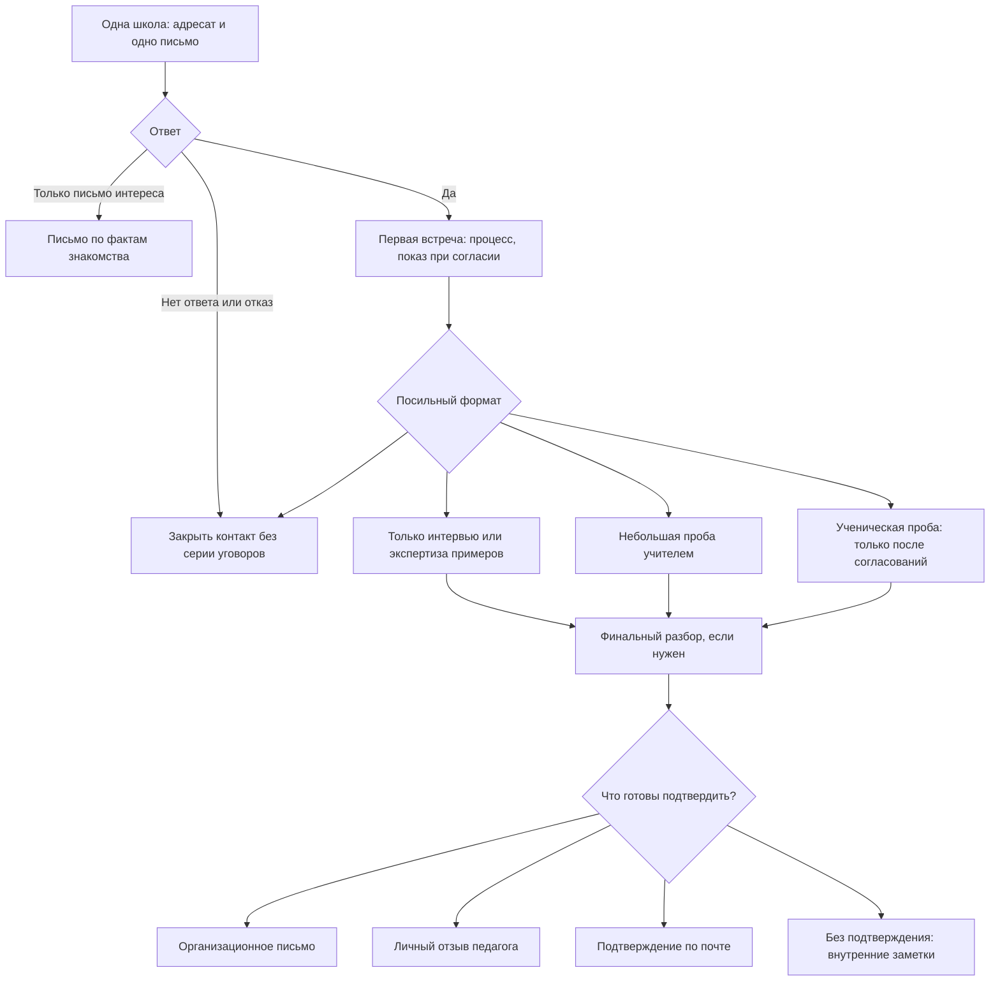

# Развилки взаимодействия со школой

Схема — рабочий инструмент команды, а не модель гарантированной конверсии. Один исходящий контакт и не более двух содержательных встреч. Интервью без пилота и проба без подписи — допустимые результаты. Отдельное согласование требуется для ученического доступа и реальных материалов.

Полная схема с отдельным условием допуска учеников и фиксацией исходов: [school-funnel.mmd](school-funnel.mmd).

## Два поля вместо одного статуса «школа согласна»

| Участие | Документирование |
|---|---|
| Не состоялось / интервью / экспертиза / проба педагогом / проба учениками | Нет подтверждения / письмо по почте / личный подписанный отзыв / письмо от организации |

Например: «проба педагогом проведена, подпись не получена» и «интерес школы подтверждён письмом, проба не проводилась» — разные честные результаты. Внутренние заметки не становятся одобрением школы. Подписанный документ не доказывает измерение, которого не проводили.

Если доступ учеников не согласован, взрослый формат можно сохранить. Если нет времени на пробу до1декабря, допустимо договориться о будущей проверке и приложить соответствующее по содержанию свидетельство интереса. Дедлайн гранта не является основанием ускорять несогласованный доступ.
